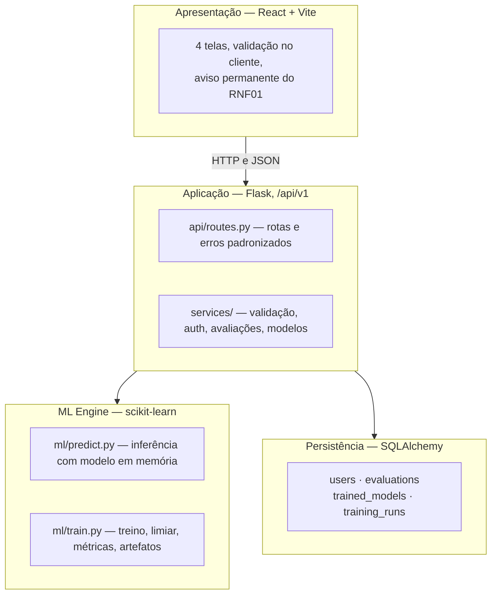
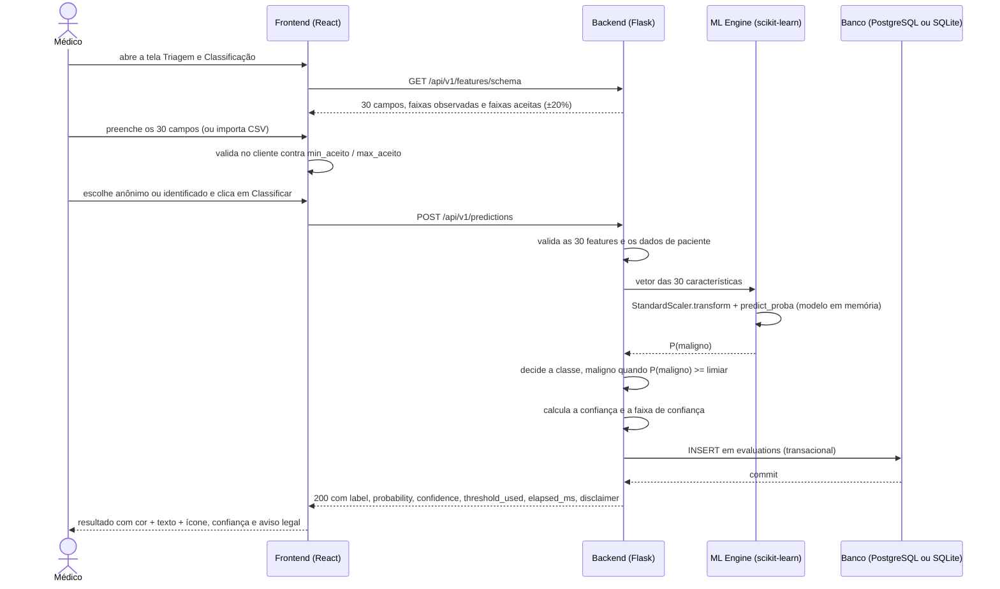
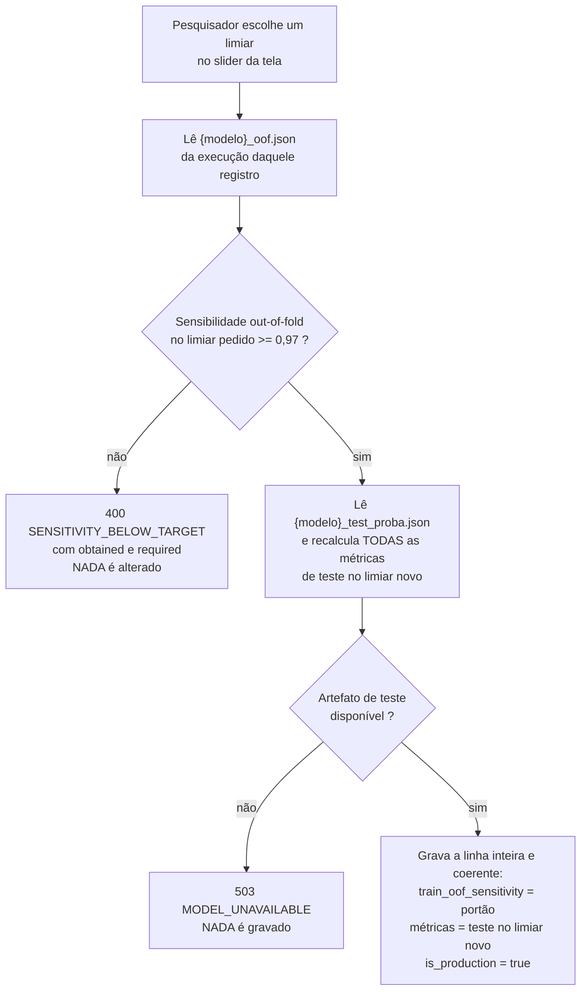
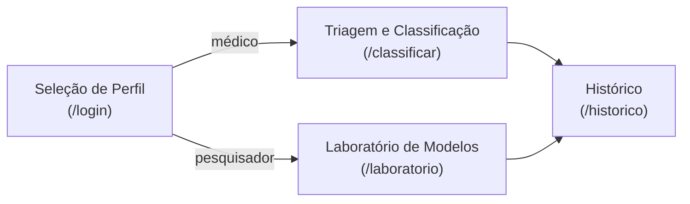

# Como o sistema funciona

Documentação funcional do TCC "Classificação de risco de câncer de mama a partir de
dados de biópsia" (Grupo 05). Este documento explica **o que o sistema faz, por que faz
assim e onde cada decisão está no código**. Não é um guia de instalação: os comandos
estão no [README](../README.md).

Dois leitores em mente: a equipe que vai apresentar o trabalho e o professor que vai
avaliá-lo. Identificadores de API, nomes de coluna de banco e nomes de característica
permanecem em inglês, porque é assim que estão no código e no contrato.

**Sobre os números citados aqui.** Todo número deste documento foi conferido na fonte e
tem a fonte indicada no texto. Métrica do sistema vem de artefato ou do banco; número de
literatura vem do documento de especificação do TCC — as quatro porcentagens da seção 1,
da sua **Contextualização**; a afirmação de incidência que abre a seção 1, da sua
**Introdução** —, com a referência completa do estudo original em
[Referências](#referências):

| Fonte | O que contém |
|---|---|
| `ml/artifacts/metrics.json` | métricas dos dois modelos nos dois pontos de operação, limiares, validação cruzada |
| `ml/artifacts/train_config.json`, `split.json`, `{modelo}_oof.json` | partição, semente, hiperparâmetros, versões, hashes, vetores out-of-fold |
| `ml/artifacts/feature_importance.json` | ranking de importância por permutação |
| `instance/tcc_cancer_mama.db` | o que o sistema em execução realmente gravou (tabelas `trained_models`, `training_runs`, `evaluations`, `users`) |
| `c:/Users/isaiaslm/tcc-docs/01_documentacao_software.txt` | os quatro números epidemiológicos da seção 1 (Contextualização) e a afirmação de incidência que a abre (Introdução) |
| página do WDBC no UCI Machine Learning Repository | procedência e DOI da base |

---

## Índice

1. [O problema e o recorte](#1-o-problema-e-o-recorte)
2. [Os dados](#2-os-dados)
3. [O caminho completo de uma classificação](#3-o-caminho-completo-de-uma-classificação)
4. [O limiar de segurança](#4-o-limiar-de-segurança)
5. [Reprodutibilidade (RNF03)](#5-reprodutibilidade-rnf03)
6. [Os dois perfis, e o que a autenticação faz e não faz](#6-os-dois-perfis-e-o-que-a-autenticação-faz-e-não-faz)
7. [As quatro telas](#7-as-quatro-telas)
8. [A API, agrupada por fluxo](#8-a-api-agrupada-por-fluxo)
9. [Rastreabilidade](#9-rastreabilidade)
10. [Limitações e honestidade metodológica](#10-limitações-e-honestidade-metodológica)

[Referências](#referências) · [Para saber mais](#para-saber-mais)

---

## 1. O problema e o recorte

O câncer de mama é a neoplasia maligna mais incidente entre mulheres no Brasil,
excluídos os tumores de pele não melanoma (INCA, 2022; Muxagata et al., 2026 — as duas
fontes que a **Introdução** do documento de especificação do TCC atribui a essa
afirmação; entradas (4) e (5) em [Referências](#referências)). O problema que motiva
este trabalho não é a ausência de exames: é o que acontece **entre** o exame e a
confirmação.

**Fonte dos números desta seção.** As quatro porcentagens abaixo vêm da
**Contextualização do documento de especificação do TCC**
(`c:/Users/isaiaslm/tcc-docs/01_documentacao_software.txt`), conferidas ali. Os estudos
originais, de acesso aberto, estão em [Referências](#referências) como (2) e (3).

- Duijm et al. (2025), em estudo populacional de rastreamento mamográfico na Holanda:
  **26,6%** dos casos diagnosticados enfrentaram algum tipo de atraso na confirmação da
  doença, e **entre 20% e 25%** dos tumores correspondiam a **falsos negativos** —
  lesões que já se mostravam visíveis em exames anteriores e não foram identificadas na
  avaliação inicial.
- Lameijer et al. (2020), analisando pacientes reconvocadas cuja confirmação tumoral
  atrasou dois anos ou mais: **74,2%** dessas falhas decorreram de equívocos de
  interpretação radiológica ou de classificação BI-RADS, e **18,4%** dos atrasos
  resultaram de **falsos negativos na própria biópsia**, por erro de amostragem do
  tecido histológico.

> **Pergunta aberta para a equipe, antes da defesa.** Estas quatro porcentagens estão
> conferidas contra a Contextualização do documento do TCC, **não** contra o texto
> integral dos dois artigos — os PDFs não foram abertos na elaboração deste documento,
> e nenhuma contagem bruta ou subseção de artigo é afirmada aqui. Com (2) e (3) em mãos,
> vale localizar cada valor na fonte primária e anotar em que ponto do artigo ele
> aparece: é exatamente o tipo de número que uma banca pede para apontar no original.

O padrão é claro: o erro que mais custa neste domínio é **deixar passar um caso
maligno**, porque ele se converte em atraso de tratamento. Esse é o recorte do sistema.

### O que o sistema faz

Recebe as 30 medidas quantitativas de uma punção aspirativa por agulha fina (FNA),
classifica o caso entre **benigno** e **maligno**, informa o **grau de confiança**,
registra a avaliação em um histórico consultável e oferece ao pesquisador um laboratório
para treinar, comparar e promover modelos (Regressão Logística e SVM) com métricas
reprodutíveis.

A prioridade de projeto é explícita e está no RNF04: **minimizar falsos negativos e
reportar essa taxa de forma explícita**. É dessa prioridade que nasce o limiar de
segurança da seção 4, que é a parte central do trabalho.

### O que o sistema NÃO faz

- **Não tem caráter diagnóstico.** É apoio à decisão, nada além disso.
- **Não substitui o laudo histopatológico** nem a avaliação médica especializada.
- **Não é dispositivo médico certificado** e não foi validado clinicamente.
- **Não processa imagens.** Recebe medidas numéricas já extraídas (ver seção 2).
- **Não decide nada sozinho.** Mesmo quando a classificação aponta malignidade com
  altíssima confiança, o resultado é uma indicação de que o caso merece atenção, não
  uma conclusão.

Esse recorte não é modéstia protocolar: é a razão pela qual o aviso do RNF01 fica
permanentemente visível em todas as telas (`frontend/src/App.jsx`, barra
`disclaimer-bar` com `role="note"`), e não apenas na tela de resultado.

Por que o recorte é esse: um classificador treinado sobre uma base pública única, de uma
instituição, sem validação externa e sem acompanhamento clínico dos casos, não tem como
sustentar afirmação diagnóstica. O que ele pode fazer com honestidade é **direcionar
atenção** — ordenar o que olhar primeiro, e sinalizar quando uma medida se parece com o
padrão dos casos malignos da base. A seção 10 detalha os limites disso.

---

## 2. Os dados

A base é o **Wisconsin Diagnostic Breast Cancer Dataset** (WDBC, UCI Machine Learning
Repository), em `data/wdbc.data`. A referência completa já consta da lista de REFERÊNCIAS
do documento do TCC, com DOI (`WOLBERG, W.` *et al.*, UCI Machine Learning Repository,
1993, DOI `https://doi.org/10.24432/C5DW2B`), e está reproduzida em
[Referências](#referências) como primeira entrada. Essa parte do item (a) do feedback do
professor — "incluam a fonte original e o repositório UCI" — **já está fechada**. Do item
(a) restam dois pontos de redação: uma oração da Introdução e o nome do dataset no
Abstract, listados na seção 6.

**A base é TABULAR.** Conferido no arquivo: 569 linhas, 32 colunas (`id`, `diagnosis` e
as 30 características), com 357 casos benignos e 212 malignos. Cada linha é um caso, e
cada característica é um número — **não** são imagens de biópsia. As medidas foram
extraídas por processamento de imagem de **punção aspirativa por agulha fina (FNA)**,
um procedimento citológico, e a base publica apenas as medidas resultantes.

Essa distinção importa na apresentação: dizer que o sistema "analisa imagens de biópsia"
descreve um sistema diferente deste, com outros riscos e outra validação.

### As 10 medidas base × 3 variações = 30 características

Cada núcleo celular identificado na imagem rende dez medidas de forma e textura
(`ml/data.py`, lista `_MEDIDAS` e rótulos em `MEDIDAS_PT`):

| Medida (API) | Rótulo | O que descreve |
|---|---|---|
| `radius` | Raio | distância média do centro do núcleo ao seu contorno |
| `texture` | Textura | variação dos tons de cinza dentro do núcleo |
| `perimeter` | Perímetro | comprimento do contorno |
| `area` | Área | área delimitada pelo contorno |
| `smoothness` | Suavidade | variação local do raio ao longo do contorno |
| `compactness` | Compacidade | relação entre perímetro e área (perímetro²/área − 1) |
| `concavity` | Concavidade | intensidade das reentrâncias do contorno |
| `concave_points` | Pontos côncavos | quantidade de reentrâncias do contorno |
| `symmetry` | Simetria | simetria do núcleo em relação ao eixo maior |
| `fractal_dimension` | Dimensão fractal | irregularidade do contorno |

Como cada imagem tem muitos núcleos, cada medida aparece em **três agregações** sobre o
conjunto de núcleos daquele caso (`GRUPOS_PT` em `ml/data.py`):

- `mean_*` — **média** da medida entre os núcleos;
- `se_*` — **erro padrão** da média, isto é, quanto a medida variou entre os núcleos;
- `worst_*` — **pior valor**, a média dos três maiores valores observados.

Daí as 30 colunas: 10 × 3. As três agregações não são redundantes: um caso maligno pode
ter a maioria dos núcleos de aparência comum e alguns poucos bem alterados — a média
dilui esses poucos, o "pior valor" não. Neste projeto, é o grupo `worst_*` que mais pesa
no modelo: para o modelo em produção, as três características mais relevantes no ranking
de importância por permutação são `worst_texture`, `worst_symmetry` e `worst_concavity`,
seguidas de `worst_concave_points`, `mean_concave_points` e `mean_concavity` (fonte:
`ml/artifacts/feature_importance.json`, método de permutação com 30 repetições, medindo
o aumento médio da log-loss no conjunto de teste).

### Faixas aceitas no formulário

`GET /api/v1/features/schema` publica, para cada característica, o mínimo e o máximo
**observados na base** e a faixa efetivamente aceita na validação: a faixa observada
mais uma margem de 20% da amplitude, nunca abaixo de zero (`ml/data.py:feature_schema`,
constante `MARGEM_FAIXA = 0.20`). A margem existe porque um caso novo pode legitimamente
cair um pouco fora do envelope de 569 casos; um valor muito distante disso é mais
provavelmente erro de digitação ou de unidade.

A base não publica unidades físicas para essas medidas (são adimensionais ou razões
derivadas de pixels), então o campo `unit` do schema é sempre nulo e a interface não
exibe unidade.

---

## 3. O caminho completo de uma classificação

Antes do passo a passo, onde cada coisa acontece. A arquitetura é em quatro camadas, e a
regra que as separa é simples: o frontend nunca toca banco nem engine de ML — ele só
conhece a API.





Passo a passo, com o ponto do código:

1. **Formulário.** A tela carrega o schema das 30 características e monta dez
   `fieldset`, um por medida base, com três campos cada — não uma lista corrida de 30
   inputs (`frontend/src/pages/ClassificarPage.jsx`). Há botões para preencher com um
   caso real da base (um maligno e um benigno) e para importar CSV.

2. **Validação no cliente com margem de 20%.** Cada campo é checado contra
   `min_aceito` / `max_aceito` do schema, que já embutem a margem
   (`ClassificarPage.jsx:validarCampo`). Isso é conveniência, não segurança: o servidor
   revalida tudo em `services/validation.py:validar_caracteristicas`, rejeitando campo
   ausente, valor não numérico, não finito ou fora da faixa aceita.

3. **`POST /api/v1/predictions`.** A rota (`api/routes.py:criar_predicao`) exige sessão
   válida, valida o corpo, marca o tempo com `time.perf_counter()` e chama a inferência.

4. **Padronização.** `ml/predict.py:predict` aplica o `StandardScaler` **ajustado no
   treino** e carregado de `ml/artifacts/scaler.joblib`. Ajustar o scaler no treino e
   só aplicá-lo depois é o que impede o conjunto de teste de influenciar a escala; é
   também o que torna o SVM comparável, porque kernel RBF é sensível à escala.

5. **Modelo em memória.** Scaler, modelos e metadados são carregados uma única vez
   (`load_bundle`, com `lru_cache`) e reaproveitados. É isso que mantém a inferência
   muito abaixo do limite de 2 segundos do RNF02 — na verificação, os três registros
   gravados em `evaluations` têm `elapsed_ms` de 22, 1 e 1 ms (fonte:
   `instance/tcc_cancer_mama.db`, coluna `elapsed_ms`).

6. **Probabilidade.** `predict_proba` devolve `P(maligno)`.

7. **Comparação com o limiar.** A classe é decidida por `P(maligno) >= limiar`, e o
   limiar é o **limiar de segurança do melhor modelo registrado em `metrics.json`** (o
   modelo nomeado no campo `melhor_modelo` do próprio artefato; `predict` não consulta o
   banco — ver D9 na seção 5). Hoje é **0,31**, da Regressão Logística (fonte:
   `ml/artifacts/metrics.json`, campo `limiar_seguranca`; o mesmo valor aparece em
   `trained_models.threshold` no banco).

8. **Faixa de confiança.** A confiança é a probabilidade **da classe prevista**:
   `P(maligno)` se maligno, `1 − P(maligno)` se benigno. A faixa é `alta` (≥ 0,90),
   `media` (0,70 a 0,90) e `baixa` (< 0,70) — `ml/predict.py:faixa_confianca`. Nota de
   contrato: o valor da API é `media`, **sem acento**; o acento em "média" só aparece no
   texto da interface.

9. **Gravação em `evaluations`.** `services/avaliacoes.py:registrar` grava features,
   rótulo, probabilidade, confiança, faixa, modelo, limiar usado, modo, `elapsed_ms` e
   data em uma transação. A resposta só sai depois do commit, para não existir resultado
   exibido que não esteja no histórico. O registro é **imutável**: listeners
   `before_update` e `before_delete` em `db/models.py` levantam erro se a aplicação
   tentar alterá-lo ou removê-lo.

10. **Resposta.** Inclui o `disclaimer` do RNF01 e o campo auxiliar
    `safety_threshold_triggered`, que marca os casos classificados como malignos com
    `P(maligno) < 0,50` — ou seja, os casos que só foram sinalizados **por efeito do
    limiar de segurança**. A interface exibe uma nota específica nesses casos.

Se o modelo não estiver disponível, a resposta é 503 `MODEL_UNAVAILABLE`; se a
classificação ultrapassar 2 segundos, é 504 `TIMEOUT` e **nada é gravado**. Nos dois
casos o formulário preenchido é preservado na tela.

### Por que `P(maligno) >= limiar` e nunca `predict()`

`predict()` do scikit-learn aplica um corte fixo em 0,50: ele devolve a classe mais
provável. Isso embute uma premissa que é falsa neste domínio — que errar para um lado
custa o mesmo que errar para o outro.

Como o limiar de segurança deste projeto é **menor** que 0,50 (0,31 para a Regressão
Logística), usar `predict()` descartaria exatamente o mecanismo que reduz falsos
negativos. O efeito é mensurável na mesma partição de teste, no mesmo modelo (fonte:
`ml/artifacts/metrics.json`, blocos `teste_padrao` e `teste_operacao` da
`regressao_logistica`):

| | `predict()` equivale a limiar 0,50 | limiar de segurança 0,31 |
|---|---|---|
| Sensibilidade (teste) | 0,9286 | **0,9762** |
| Taxa de falsos negativos | 0,0714 | **0,0238** |
| Especificidade (teste) | 0,9861 | 0,9861 |
| Acurácia (teste) | 0,9649 | **0,9825** |
| Matriz de confusão | vn 71 · fp 1 · fn 3 · vp 39 | vn 71 · fp 1 · fn 1 · vp 41 |

Dois casos malignos que o corte de 0,50 classificaria como benignos passam a ser
sinalizados, sem custo nenhum de especificidade nesta partição. É por isso que
`ml/predict.py` compara a probabilidade com o limiar à mão, e há teste automatizado
cobrindo justamente isso (`tests/test_predict.py`).

---

## 4. O limiar de segurança

Esta é a parte mais importante do trabalho, e vale explicá-la sem jargão.

### Por que um falso negativo é muito mais grave que um falso positivo

São dois erros com consequências assimétricas:

- **Falso positivo** — o sistema sinaliza malignidade em um caso benigno. A consequência
  é investigação adicional: mais um exame, mais uma avaliação, ansiedade e custo. É um
  erro corrigível pelo próprio processo clínico, porque o passo seguinte é justamente
  confirmar.
- **Falso negativo** — o sistema não sinaliza um caso que é maligno. A consequência é
  que o caso **sai da fila de atenção**. Nada no fluxo seguinte vai corrigir isso, e o
  custo é tempo: é exatamente o atraso diagnóstico que a seção 1 descreve, com o tumor
  progredindo enquanto ninguém está olhando.

Não são erros do mesmo tamanho, então o sistema não os trata do mesmo jeito.

### O que é sensibilidade e por que a meta é 0,97

**Sensibilidade** é a fração dos casos **realmente malignos** que o sistema consegue
sinalizar como malignos. Sensibilidade de 0,97 significa: de cada 100 casos malignos,
97 são sinalizados e 3 passam. É a métrica espelho da taxa de falsos negativos
(sensibilidade + taxa de falsos negativos = 1).

Ela não deve ser confundida com **especificidade**, que é a fração dos casos realmente
benignos corretamente classificados como benignos, nem com **acurácia**, que mistura as
duas e por isso esconde o erro que importa: em uma base com mais benignos que malignos,
é possível ter acurácia alta errando justamente nos malignos.

A meta de **0,97** é a meta de segurança clínica do projeto. Ela está codificada em um
único lugar, `SENSIBILIDADE_MINIMA = 0.97` em `ml/train.py`, e é consumida pela escolha
do limiar e pelo portão de promoção. É um compromisso declarado: o sistema aceita pagar
em falsos positivos para chegar perto de não deixar maligno passar, e **recusa** colocar
em produção um modelo que não atinja esse patamar.

### Como o limiar é escolhido

A regra está em `ml/train.py:escolher_limiar_seguranca`:

> O **maior** limiar menor ou igual a 0,50 que ainda mantém a sensibilidade ≥ 0,97.

A busca percorre a grade de 0,01 a 0,50, em passos de 0,01, de cima para baixo, e para
no primeiro limiar que satisfaz a meta. Por que o maior, e não simplesmente o menor
possível? Porque baixar o limiar aumenta a sensibilidade e, ao mesmo tempo, aumenta os
falsos positivos. Um limiar de 0,01 sinalizaria quase tudo como maligno — sensibilidade
perfeita e utilidade nenhuma. A regra lê assim: *atinja a meta de segurança e, dentro
dessa restrição, incomode o mínimo possível*. Se nenhum limiar da grade atingir a meta,
o treino adota o mais cauteloso disponível e registra `limiar_atingiu_meta_no_treino`
como falso, para o fato não passar silencioso.

Os limiares resultantes (fonte: `ml/artifacts/metrics.json`): **0,31** para a Regressão
Logística e **0,38** para o SVM; os dois com `limiar_atingiu_meta_no_treino: true`.

### Por que com predições out-of-fold do treino, e nunca com o teste

Esta é a regra que protege a honestidade dos números reportados.

Escolher limiar é **ajustar o modelo**. Se o limiar for escolhido olhando o conjunto de
teste, o teste deixa de ser uma avaliação independente: ele passou a participar da
construção do classificador, e a métrica que ele reporta fica otimista por construção.
É vazamento de informação, e invalida justamente a frase que o trabalho quer poder
dizer — "neste conjunto que o modelo nunca viu, a sensibilidade foi X".

A solução é obter, **dentro do treino**, predições que o modelo não fez sobre dados que
ele viu. É o papel das predições **out-of-fold**: o conjunto de treino é dividido em 5
dobras estratificadas (`StratifiedKFold(5, shuffle=True, random_state=42)`); para cada
dobra, o modelo é ajustado nas outras quatro e prediz a dobra que ficou de fora
(`cross_val_predict` em `ml/train.py:_oof_proba`). O resultado é um vetor de
probabilidades para todos os 455 casos de treino, cada uma produzida por um modelo que
não viu aquele caso. O limiar é escolhido nesse vetor, que fica persistido em
`{modelo}_oof.json` para a promoção poder recalcular o portão depois, sem re-treinar.

Assim: **quem decide é o out-of-fold do treino; quem reporta é o conjunto de teste.**

### As duas grandezas, depois da correção do Defeito A

Havia um defeito grave aqui, agora corrigido, e vale explicá-lo porque ele explica a
forma atual do banco e da tela.

Antes, um único campo (`trained_models.sensitivity`) era usado para duas coisas
diferentes: o valor que **autoriza** a promoção e a métrica que é **reportada**. Na
prática, promover um modelo sobrescrevia a sensibilidade de teste com o valor
out-of-fold — e o número exibido como "sensibilidade no conjunto de teste" passava a ser
um número do treino.

A correção (decisão **D11**) separou as duas grandezas em campos próprios:

| Grandeza | Onde fica | Calculada sobre | Para que serve |
|---|---|---|---|
| **Portão out-of-fold** | `trained_models.train_oof_sensitivity` | predições out-of-fold do **treino**, no limiar da linha | é o número comparado com 0,97 para autorizar a promoção |
| **Métricas reportadas** | `accuracy`, `sensitivity`, `specificity`, `auc`, `false_negative_rate`, `confusion_matrix` | **conjunto de teste** daquela execução, no limiar vigente | é o desempenho que se cita no artigo e na defesa |

O valor out-of-fold **nunca** é gravado em `sensitivity`. E as métricas de teste são
sempre recalculadas **em conjunto** (`services/modelos.py:metricas_teste_no_limiar`, que
reusa `ml.train.compute_metrics`), a partir das probabilidades de teste persistidas em
`{modelo}_test_proba.json` — nunca uma linha meio atualizada, misturando limiar novo com
métricas do limiar antigo. Se esse artefato faltar, a rota devolve 503
`MODEL_UNAVAILABLE` **sem gravar nada**.

Há invariante verificada automaticamente em `tests/test_metricas_coerentes.py`, sobre
toda linha de `trained_models`: `sensitivity == vp/(vp+fn)`,
`false_negative_rate == fn/(vp+fn)`, `specificity == vn/(vn+fp)` e
`accuracy == (vn+vp)/total`, sempre contra a própria `confusion_matrix` da linha.

Os dois números, para a Regressão Logística em produção, no limiar 0,31:

- **Portão out-of-fold do treino: 0,9706.** Conferido no vetor
  `ml/artifacts/regressao_logistica_oof.json`: dos 170 casos malignos do conjunto de
  treino, **165** têm probabilidade out-of-fold ≥ 0,31 — 165/170 = 0,970588. É o mesmo
  valor gravado em `trained_models.train_oof_sensitivity` no banco. É este número que
  passa pela comparação com 0,97.
- **Sensibilidade no conjunto de teste: 0,9762.** Fonte: `ml/artifacts/metrics.json`,
  bloco `teste_operacao`; e `trained_models.sensitivity` no banco. É este número que se
  reporta como desempenho.

Os dois coexistem, são diferentes e não se substituem. Na apresentação: "o portão de
promoção foi 97,06%, calculado out-of-fold no treino; a sensibilidade reportada é
97,62%, no conjunto de teste".

### A promoção, e o RNF04

`PUT /api/v1/models/{id}/threshold` é a materialização da regra
(`api/routes.py:ajustar_threshold`):



O RNF04 ("priorizar a minimização de falsos negativos, reportando essa taxa de forma
explícita") está cumprido em três frentes: a taxa de falsos negativos é calculada e
reportada em todos os pontos de operação (`taxa_falsos_negativos` em
`ml/train.py:compute_metrics`, propagada a `trained_models.false_negative_rate` e à
API); o limiar é escolhido pela regra de sensibilidade mínima; e a promoção fica
bloqueada abaixo da meta, com erro explícito em vez de aceitação silenciosa.

Esse bloqueio é demonstrável, e é um bom momento da apresentação: tentar promover o SVM
com limiar 0,95 devolve 400 `SENSITIVITY_BELOW_TARGET` com `obtained: 0.7353` e
`required: 0.97`, sem alterar nada. O valor é conferível no vetor
`ml/artifacts/svm_oof.json`: no limiar 0,95, só 125 dos 170 malignos do treino ficam
acima do corte — 0,7353. Com a Regressão Logística no mesmo limiar o portão daria 0,8176,
também abaixo da meta, também bloqueado.

---

## 5. Reprodutibilidade (RNF03)

O RNF03 pede que a divisão treino/teste e os hiperparâmetros sejam documentados e
versionados "para reprodutibilidade do artigo". A leitura adotada aqui é forte: **um
terceiro deve conseguir reconstruir exatamente o experimento que produziu os números
citados**, não um experimento parecido.

Para isso, `ml/train.py:train_and_evaluate` grava, a cada treino:

| O que | Onde | Por que |
|---|---|---|
| Semente **42** | `train_config.json:random_state`, `split.json:random_state`, `trained_models.random_seed` | fixa a partição, o embaralhamento das dobras e o estado dos estimadores; sem ela, nada é repetível |
| **Índices** de cada partição | `split.json`, chaves `treino` (455 índices) e `teste` (114) | semente sozinha não basta: ela depende de versão de biblioteca. Os índices das linhas são a partição em si, e permitem reconstruí-la mesmo em outro ambiente |
| Hiperparâmetros | `train_config.json:hiperparametros` e dentro do próprio `.joblib` | é o que define o modelo; sem eles o `.joblib` não é auditável |
| Versões das bibliotecas | `train_config.json:versoes` | algoritmo numérico muda entre versões; sem registro, uma diferença de resultado fica sem explicação |
| Commit do git | `train_config.json:commit_git` | amarra os artefatos ao código exato que os produziu |
| **SHA-256** do dataset e de cada artefato | `train_config.json:hashes_sha256`, `trained_models.artifact_sha256` | procedência: prova que o `.joblib` avaliado é o mesmo bytes a bytes, e que a base não mudou |

Valores da referência atual (fonte: `ml/artifacts/train_config.json`):

- partição: `test_size = 0.2`, estratificada, `random_state = 42`;
- **455** casos de treino (285 benignos, 170 malignos) e **114** de teste (72 benignos,
  42 malignos) — conferido também em `split.json`, que tem 455 e 114 índices;
- validação cruzada: `cv_folds = 5`;
- versões: Python **3.14.6**, scikit-learn **1.9.1**, numpy **2.5.0**, joblib **1.6.0**;
- `commit_git`: `096bc54787318a90f40840bd51644a43b6dd4bab`;
- SHA-256 do dataset:
  `11218503215d46bf9eb4e9bcf7da97b878f0cdae46c75863d00e5009ab91a76c`;
- hiperparâmetros da Regressão Logística: `C=1`, `penalty=l2`, `solver=lbfgs`,
  `max_iter=1000`, `random_state=42`;
- hiperparâmetros do SVM: `C=10`, `kernel=rbf`, `gamma=scale`, `probability=True`,
  `random_state=42`.

### Referência versionada × artefatos por execução (D8)

Havia um problema real aqui: o treino disparado pela tela do Laboratório gravava em
`ml/artifacts/`, o **mesmo diretório** da referência citada no artigo. Um treino
disparado durante a defesa, com outra fração de teste, sobrescreveria silenciosamente os
números publicados.

A separação (decisão **D8**):

```
ml/artifacts/                      ← REFERÊNCIA VERSIONADA do artigo
  scaler.joblib                      split 80/20, semente 42
  regressao_logistica.joblib         regerada SOMENTE por `python -m ml.train`
  svm.joblib                         nenhuma rota da API escreve aqui
  {modelo}_oof.json                  (insumo do portão de promoção)
  {modelo}_test_proba.json           (insumo do recálculo das métricas de teste)
  metrics.json, train_config.json, split.json, feature_importance.json
  report/                            DERIVADO, NÃO versionado (no .gitignore):
                                     figuras 300 DPI + CSV regerados por `ml.report`

ml/artifacts/runs/{training_run_id}/   ← ARTEFATOS DAQUELA EXECUÇÃO
  mesma estrutura, inclusive report/     descartáveis, no .gitignore
                                         é aqui que POST /training-runs grava
```

Versionados, de fato, são os onze arquivos das linhas acima de `report/` — os três
`.joblib`, os quatro JSON de metadados e os quatro `_oof.json` / `_test_proba.json`
(conferido com `git ls-files ml/artifacts`). As figuras e o CSV do artigo ficam fora do
git porque são derivados reconstruíveis desses onze; o RNF03 se sustenta nos insumos,
não nos gráficos.

Consequência prática verificável: `git status --porcelain ml/artifacts` continua vazio
depois de um `POST /api/v1/training-runs`. E consequência de arquitetura (decisão
**D9**): a classificação (`POST /predictions`) usa **sempre** os artefatos de referência.
Promover um modelo nascido de um treino sob demanda registra o novo ponto de operação no
banco e na tela, mas **não troca o artefato que classifica**; para tornar uma execução a
nova referência, roda-se `python -m ml.train` e recomitam-se os artefatos.

### Correção do Defeito B: um registro por execução

A tabela `trained_models` tinha `artifact_sha256` como chave única, partindo da premissa
de que bytes iguais significam o mesmo modelo. A premissa é errada justamente porque o
treino é determinista: dois treinos com a mesma semente e os mesmos dados produzem
legitimamente os mesmos bytes. O efeito era que um modelo nascido de uma execução 70/30
**reaproveitava o registro** da referência 80/20, e seu `artifact_path` passava a
apontar para o artefato da outra partição. A partir daí, o portão de promoção lia o
`_oof.json` errado.

A correção (decisão **D12**):

- a unicidade passou a ser **`(training_run_id, name)`**
  (`uq_trained_models_run_name` em `db/models.py`) — uma linha por (execução, modelo);
- `artifact_sha256` continua gravado como **procedência** (RNF03), mas sem `unique`;
- **`artifact_path` aponta sempre para o artefato da própria execução**:
  `ml/artifacts/{nome}.joblib` para a referência,
  `ml/artifacts/runs/{id}/{nome}.joblib` para um treino sob demanda. É esse caminho que
  a promoção usa para localizar o `_oof.json` e o `_test_proba.json` corretos
  (`services/modelos.py:diretorio_artefatos_do_registro`).

No estado de demonstração preparado por `.agents/preparar_demo.py`, conferido em
`instance/tcc_cancer_mama.db`: duas linhas em `trained_models`, ambas da execução
`training_run_id = 1` (o registro sintético que representa o treino de referência
versionado), com `artifact_path` `ml/artifacts/regressao_logistica.joblib` e
`ml/artifacts/svm.joblib` — a procedência correta delas. A Regressão Logística está com
`is_production = 1`. Vale lembrar que esse arquivo de banco é descartável e está no
`.gitignore`: qualquer treino disparado na defesa acrescenta linhas, e o estado deixa de
ser esse.

Como o projeto não usa Alembic, essa mudança de schema é aplicada por **recriação**:
apagar `instance/tcc_cancer_mama.db` (SQLite) ou `DROP SCHEMA public CASCADE; CREATE
SCHEMA public;` (PostgreSQL) e subir a aplicação, que executa `create_all()` e
`sincronizar_modelos()`.

### Uma ressalva: o registro sintético grava `grid_search` errado

A linha `training_runs` de `id = 1` não nasceu de uma execução pela API: ela é criada por
`services/modelos.py:sincronizar_modelos` para representar, no banco, o treino de
referência que já veio versionado. Ela reproduz corretamente semente, partição, versões,
commit e hash do dataset, mas grava `grid_search = 0` (conferido em
`instance/tcc_cancer_mama.db`, tabela `training_runs`), com um comentário no código
afirmando que os artefatos versionados não usaram GridSearchCV.

Esse comentário está errado, e os artefatos provam: `ml/artifacts/train_config.json`
registra `"grid_search": true`, `ml/train.py:train_and_evaluate` tem `grid_search=True`
como padrão, e `python -m ml.train` — o único caminho que regenera a referência — chama
a função sem sobrescrever esse padrão. O `C = 10` do SVM confirma: o padrão do `SVC` é
`C = 1,0`, então esse valor só pode ter saído de busca em grade.

Consequência prática: **a fonte da verdade para reproduzir a referência é
`ml/artifacts/train_config.json`, não a linha do banco.** Quem reconstruir o experimento
a partir do registro `training_runs` treinaria sem busca em grade e obteria outro SVM.
É uma inconsistência do registro sintético, não dos artefatos, e fica aqui registrada
como ajuste pendente em `sincronizar_modelos()` — o documento não a esconde porque ela
está exatamente debaixo de uma promessa de reprodutibilidade exata.

---

## 6. Os dois perfis, e o que a autenticação faz e não faz

Dois perfis, declarados no cadastro: **médico** (triagem) e **pesquisador** (treino e
avaliação dos modelos).

### O que existe

- **É preciso estar autenticado.** Todas as rotas fora de `/auth/*` exigem cookie de
  sessão válido; sem ele, a resposta é 401 `UNAUTHENTICATED`. Isso é aplicado rota a
  rota pelo decorador explícito `exigir_sessao` em `api/routes.py`, e há teste que varre
  o `url_map` do Flask para que nenhuma rota nova escape da trava
  (`tests/test_sessao_obrigatoria.py`). Só `/auth/*` e `/health` são públicas (decisão
  **D10**).
- **A senha nunca é gravada em texto.** Hash com `werkzeug.security`, com o algoritmo
  **fixado** em `pbkdf2:sha256` (constante `METODO_HASH` em `services/auth.py`, passada
  como `method=` na chamada de `generate_password_hash`). `services/auth.py` é o único
  módulo que escreve essa coluna (decisão **D4**).
  Antes, a chamada ia sem o argumento `method` e pegava o padrão da versão instalada do
  Werkzeug, que hoje é **scrypt** — divergindo dos **três lugares** que documentam
  pbkdf2: a decisão **D4** da especificação consolidada, a **docstring de
  `services/auth.py`** e este documento. O algoritmo passou a ser explícito no código,
  e os três convergem. Há teste fixando o prefixo do hash gravado
  (`tests/test_auth.py:test_hash_gravado_usa_pbkdf2_sha256_como_d4_documenta`).
  As **duas contas do banco de demonstração** foram criadas antes da correção e seguem
  com hash scrypt (conferido em `instance/tcc_cancer_mama.db`: `users.password_hash`
  começa com `scrypt:32768:8:1$` nas duas linhas). Elas continuam entrando normalmente,
  porque `check_password_hash` identifica o algoritmo pelo prefixo do hash armazenado —
  verificado em requisição real contra o servidor em execução (login de
  `medico@demo.local` → 200) e coberto por teste
  (`test_login_de_conta_antiga_com_hash_scrypt_continua_funcionando`). Cadastro novo
  grava `pbkdf2:sha256:1000000$`.
- **O perfil escolhido no cadastro define apenas quais telas aparecem.** O menu é
  renderizado a partir de `ITENS_MENU` em `frontend/src/App.jsx`.

### O que NÃO existe

**Não há controle de autorização.** Nenhuma rota verifica `profile` — nem no backend,
nem em lugar nenhum (decisão **D3**, pedido explícito da equipe pelo prazo). Um médico
autenticado chama as rotas do pesquisador e vice-versa. O menu por perfil é uma guarda
de **interface**, não de acesso: digitar a URL de outra tela carrega normalmente.

Não há também JWT, nem RBAC, nem tabela de auditoria — tudo isso aparece nos diagramas
de sequência do documento original e foi deliberadamente retirado do código.

### As consequências, ditas com franqueza

1. **O histórico identificado é legível por qualquer usuário autenticado.** Qualquer
   conta, de qualquer perfil, consegue listar `GET /api/v1/predictions` inteiro, com
   `patient_name` e `patient_record` de todos os casos. Não há filtro por autoria: o
   `evaluations.user_id` registra quem classificou, mas não restringe quem lê.
2. **Os dados de paciente ficam em texto no banco.** A criptografia AES-256-GCM
   prometida pelo RNF05 foi removida (decisão **D2**). No modo identificado, nome e
   prontuário são gravados em texto puro em `evaluations.patient_name` /
   `patient_record`. A própria tela de classificação exibe esse aviso quando o modo
   identificado é escolhido.
3. **Qualquer usuário autenticado dispara treinos e promove modelos.** Inclusive uma
   conta de perfil médico.

Isso deixa **pendências de documento**, não de código — **sete**, todas de redação a
corrigir na versão final do `.docx`. A contagem mudou de composição nesta revisão, não de
total: saiu a divergência do hash (pbkdf2 × scrypt), porque ela foi resolvida **no
código** e não na redação (bullet acima), e entrou o item (b) do feedback do professor,
que faltava na lista.

1. **RNF05 e o FA01 do UC07** ainda prometem armazenamento criptografado em
   conformidade com a LGPD. Precisam descrever o que foi construído: modo identificado
   gravando em texto puro, com a ferramenta restrita a ambiente controlado (D2).
2. **A trava de sensibilidade está enunciada como "no conjunto de teste".** A seção que
   descreve o Módulo Laboratório de Modelos e Avaliação Científica (§4.2.4) diz
   "sensibilidade mínima de (97%) no conjunto de teste". Por **D11**, o portão é
   avaliado nas predições out-of-fold do treino, e é justamente por isso que o SVM hoje
   **passa** no portão (0,9706) e **não** atende à meta no teste (0,9524) — ver seção 4.
   Quem ler o documento do TCC e a tela do Laboratório lado a lado encontra a
   contradição. O diagrama da §4.2.4 não entra nessa pendência: os dois ramos dele dizem
   apenas "Sensibilidade >= 0.97" e "Sensibilidade < 0.97", sem qualificar a partição
   (conferido em `tcc-docs/figuras/doc_image4.png`). O defeito da **Figura 6** é outro, e
   já estava na lista da equipe: a legenda diz "Diagrama de sequência do Módulo de
   Autenticação" quando o diagrama é o do Laboratório de Modelos.
3. **Os Quadros 9 e 10 não têm os requisitos do item (b) do feedback.** É a cobrança mais
   importante ainda aberta. O professor escreveu, em 08/10, que os diagramas de sequência
   e a arquitetura descrevem autenticação por perfil, banco PostgreSQL, paginação com
   filtros e promoção de modelo condicionada a sensibilidade mínima de 0,97, e que "nada
   disso está nos 7 RFs nem nos 5 RNFs (o RNF04 só diz 'priorizar minimizar falsos
   negativos', sem meta)" — `tcc-docs/03_feedback_professor.txt`, item (b), repetido no
   item (b) do "o que fazer". A própria equipe pediu o mesmo pelo WhatsApp: acrescentar
   aos requisitos o banco PostgreSQL, a paginação com filtros e a promoção condicionada a
   0,97. Conferido no documento do TCC: o **Quadro 9** (RF01 a RF07) não tem requisito de
   login, de perfis nem de paginação, e o **Quadro 10** (RNF01 a RNF05) não tem requisito
   de banco e traz o RNF04 sem meta numérica. Enquanto isso o código implementa sessão
   obrigatória (D10), `DATABASE_URL` apontando para PostgreSQL (D5), histórico paginado
   com filtros e `SENSIBILIDADE_MINIMA = 0.97`.

   Texto sugerido, no estilo dos quadros existentes, para a equipe colar no `.docx`:

   *Acrescentar ao Quadro 9 — Requisitos funcionais (ID | Descrição | Prioridade):*

   | ID | Descrição | Prioridade |
   |---|---|---|
   | RF08 | O sistema deve permitir o cadastro e o login de usuários com perfil de médico ou de pesquisador, exigindo autenticação para o acesso às demais funcionalidades. | Essencial |
   | RF09 | O sistema deve permitir consultar o histórico de avaliações de forma paginada, com filtros por classificação, modo de registro, período e faixa de confiança. | Importante |

   *Acrescentar ao Quadro 10 — Requisitos não funcionais (ID | Categoria | Descrição):*

   | ID | Categoria | Descrição |
   |---|---|---|
   | RNF06 | Portabilidade | O sistema deve persistir usuários, avaliações e modelos treinados em banco de dados relacional PostgreSQL, com a conexão definida por variável de ambiente. |

   *Substituir a descrição do RNF04, no Quadro 10:*

   | ID | Categoria | Descrição |
   |---|---|---|
   | RNF04 | Confiabilidade | O sistema deve priorizar minimizar falsos negativos (casos malignos classificados como benignos), reportando essa taxa de forma explícita, e só deve colocar em produção modelo que atinja sensibilidade mínima de 0,97 (97%), medida nas predições out-of-fold do conjunto de treino. |

   Duas observações para quem for colar isso. A primeira: a redação do RNF04 acima já
   embute a correção da pendência 2 desta lista — a meta é verificada **out-of-fold no
   treino**, não no conjunto de teste. A segunda: o item (b) do feedback também cita
   registro de auditoria e criptografia AES-256-GCM, que **não** devem entrar como
   requisito, porque foram retirados do escopo por **D2** e **D3**; é a pendência 1 desta
   lista que trata disso, descrevendo o que foi efetivamente construído. O professor pediu
   ainda que os novos requisitos fossem ligados às histórias **HT03** (perfis de médico e
   pesquisador) e **US07** (histórico), o que o RF08 e o RF09 acima permitem fazer
   diretamente no Quadro 11.
4. **Duas sobras do item (a) do feedback: uma oração da Introdução e o nome do dataset no
   Abstract.** A Introdução do documento de especificação ainda diz que a ferramenta atua
   "como sistema de suporte à decisão clínica na classificação de possíveis tumores
   malignos **em imagens de biópsia**", embora o parágrafo imediatamente seguinte já
   descreva a base corretamente, como "banco de dados **tabular** composto por 30
   características numéricas extraídas de imagens de punção aspirativa por agulha fina
   (FNA)". É uma oração incoerente com o parágrafo seguinte, não uma seção a reescrever;
   a expressão "banco de dados composto por diversas imagens de biópsias", citada no
   feedback, não existe mais no texto atual. O segundo ponto é o **Abstract**, que escreve
   "Wisconsin Diagnostic Breast Dataset", sem "Cancer" — é a única ocorrência truncada do
   documento inteiro. O **Resumo em português já está correto** ("Wisconsin Diagnostic
   Breast Cancer Dataset"), assim como as demais ocorrências do corpo e a referência:
   corrigir só o Abstract e não mexer no Resumo.
   As outras duas partes do item (a) (`tcc-docs/03_feedback_professor.txt`) **já foram
   atendidas** pela equipe, e não há o que corrigir nelas: o **UC01 já lista as
   características corretas** do WDBC (raio, textura, perímetro, área, suavidade,
   compacidade, concavidade, pontos côncavos, simetria e dimensão fractal, nas variações
   média, erro padrão e pior valor — Quadro 2, passo 3 do fluxo principal), e a
   **referência da base já consta das REFERÊNCIAS**, com DOI. Os campos alheios ao WDBC
   que o professor apontou como exemplo do UC01 não existem no texto atual: não vale
   procurar por eles.
5. **A legenda da Figura 5 promete um módulo de auditoria que não existe.** O título
   atual é "Figura 5 – Módulo de Histórico e Auditoria de Avaliações", mas a trilha de
   auditoria foi removida do escopo por **D3** — não há tabela de auditoria no sistema. A
   legenda precisa descrever o que o diagrama mostra (o Histórico de avaliações), e o
   feedback registra um segundo defeito na mesma legenda: ela não começa com "Diagrama de
   sequência", ao contrário das demais.
6. **A Lista de Figuras está vazia.** No documento atual, "LISTA DE FIGURAS" é só um
   título, sem nenhuma entrada — seguido de "LISTA DE QUADROS" e "SUMÁRIO", igualmente
   vazios. O item (d) do "o que fazer" do feedback cobra "as legendas das Figuras 3, 4 e
   6 **e a Lista de Figuras**": depois de acertar as legendas (itens 2 e 5 desta lista),
   a Lista de Figuras precisa ser gerada com os títulos finais.
7. **O FA02 do UC02 promete uma nova tentativa que o código não faz.** O Quadro 3 diz
   que, ao exceder 2 segundos, "o sistema registra o evento e tenta novamente,
   notificando o médico sobre o atraso". O código registra o evento em log e devolve 504
   `TIMEOUT` sem gravar nada e sem repetir a classificação
   (`api/routes.py:criar_predicao`) — comportamento descrito na seção 3. É divergência de
   redação, não defeito: o retry teria de ser decidido como requisito antes de existir.

> **A aplicação não deve ser exposta fora de um ambiente controlado.** Não há segregação
> de dados por usuário, cifragem em repouso nem trilha de auditoria. Ela foi construída
> para fins acadêmicos e para demonstração, com dados da base pública WDBC, e não para
> uso com dados de pacientes reais.

O modo **anônimo** é a mitigação disponível, e é o padrão da tela: nada da paciente é
armazenado, apenas as características e o resultado. `validar_paciente` em
`services/validation.py` **descarta** qualquer dado de paciente enviado quando o modo é
anônimo, em vez de apenas ignorá-lo — minimização de dados por construção. É também o
que o RF07 pede: manter histórico sem exigir identificação quando ela não for necessária.

---

## 7. As quatro telas



### 1. Seleção de Perfil (`/login`) — Figura 3

**O que resolve:** a entrada no sistema e a escolha do perfil. Alterna entre *Entrar* e
*Cadastrar*; no cadastro, o usuário informa nome, e-mail, senha (mínimo 8 caracteres) e
escolhe entre médico e pesquisador. Depois de autenticar, redireciona para a primeira
tela do perfil: `/classificar` para médico, `/laboratorio` para pesquisador.

**Atende:** a pré-condição "o médico está autenticado no sistema" do **UC01**, e o fluxo
da Figura 3 do documento, em que o usuário entra antes de qualquer operação. Não está
ligada a uma US do Quadro 11 — vem das histórias técnicas da Sprint 0: **HT03**,
"Configuração dos perfis de médico e pesquisador" (redação conferida no Quadro 12 do
documento de especificação do TCC, que lista HT01 a HT03).

**Código:** `frontend/src/pages/LoginPage.jsx`, `services/auth.py`, rotas `/auth/*`.

### 2. Triagem e Classificação (`/classificar`) — Figura 4

**O que resolve:** o fluxo principal do médico. Formulário das 30 características
agrupado pelas 10 medidas base × 3 variações, com importação de CSV (aceita cabeçalho
com os nomes, 30 valores em sequência, ou o formato original do WDBC com `id` e
`diagnosis` à frente) e botões de exemplo real da base. Escolha entre registro anônimo e
identificado. Resultado com indicação visual **por cor + texto + ícone** — nunca só por
cor —, grau de confiança em porcentagem, faixa de confiança, probabilidade de
malignidade, modelo e limiar usados, tempo de resposta e o aviso legal. Erro de
classificação não limpa o formulário.

**Atende:** **UC01** (preencher formulário) → **US01**; **UC02** (classificar tumor) →
**US02**; **UC03** (exibir grau de confiança) → **US03**. Também alimenta o **UC07**,
porque toda classificação é registrada automaticamente.

**Código:** `frontend/src/pages/ClassificarPage.jsx`.

### 3. Histórico (`/historico`) — Figura 5

**O que resolve:** consultar e filtrar o que já foi classificado. Tabela paginada, mais
recentes primeiro, com filtros por classificação, modo de registro, período e faixa de
confiança — e **os filtros refletidos na URL** (`useSearchParams`), para que um caso
possa ser compartilhado ou retomado por link. Estados de carregamento, vazio e erro
tratados.

**Atende:** **UC07** (manter histórico de avaliações) → **US07**. É a única tela visível
nos dois perfis.

**Código:** `frontend/src/pages/HistoricoPage.jsx`; consultas em
`services/avaliacoes.py:listar`, sustentadas pelos índices compostos declarados em
`db/models.py` (`(created_at)`, `(label, created_at)`, `(mode, created_at)`,
`(label, confidence)`).

### 4. Laboratório de Modelos (`/laboratorio`) — Figura 6

**O que resolve:** o trabalho do pesquisador, em cinco blocos.

- **Disparar treino** — escolha dos modelos, fração de teste e uso de GridSearchCV
  (5 dobras estratificadas, `scoring="recall"`), com acompanhamento do status da
  execução.
- **Comparação dos classificadores** — tabela do ponto de operação e tabela do limiar
  padrão 0,50. Toda coluna de métrica é rotulada **(teste)**, e o portão out-of-fold tem
  coluna separada, para ninguém reportar um pelo outro. Quando a tabela mistura
  execuções com partições de teste diferentes, um alerta `test_partitions_mixed` avisa
  que comparar aquelas métricas entre si não é válido.
- **Curvas ROC sobrepostas e matrizes de confusão** — cada matriz vem rotulada com a
  execução e a composição do conjunto de teste a que pertence.
- **Limiar de operação** — slider com a regra dos 0,97: aplicar promove o modelo se o
  portão out-of-fold permitir, e exibe o bloqueio explícito quando não permitir.
- **Características mais relevantes e reprodutibilidade** — ranking por permutação,
  bloco com semente, partição, versões, commit, hiperparâmetros e hashes, e exportação
  em CSV.

**Atende:** **UC04** (treinar classificadores) → **US04**; **UC05** (comparar
desempenho) → **US05**; **UC06** (exibir características mais relevantes) → **US06**.

**Código:** `frontend/src/pages/ModelosPage.jsx`.

---

## 8. A API, agrupada por fluxo

Prefixo `/api/v1`. Identificadores em inglês, mensagens ao usuário em português,
envelope de erro `{"error": "...", "code": "..."}`. Os códigos **emitidos pelo código**
são sete: `VALIDATION_ERROR` (400), `UNAUTHENTICATED` (401), `NOT_FOUND` (404),
`SENSITIVITY_BELOW_TARGET` (400), `MODEL_UNAVAILABLE` (503), `TIMEOUT` (504) e
`INTERNAL_ERROR` (500).

> **O envelope vale também para falha inesperada.** O `INTERNAL_ERROR` (500) do README e
> da especificação consolidada **está implementado**: `app.py` registra um
> `errorhandler` para `Exception` e outro para o código 500, que devolvem
> `{"error": ..., "code": "INTERNAL_ERROR"}` com status 500 e `Content-Type:
> application/json` — e não mais a página HTML padrão do Flask. O stack trace vai para o
> log do servidor (`app.logger.exception`) e **não** para a resposta, que traz só a
> mensagem genérica e o código. Os erros HTTP comuns (404, 405, …) não passam por esse
> handler: ele checa `isinstance(e, HTTPException)` e os deixa seguir com o tratamento
> próprio. Os dois handlers do blueprint continuam cobrindo `ErroValidacao` (400) e
> `ModeloIndisponivel` (503), e têm precedência sobre o handler de `Exception`.
> O caminho é exercitado por teste que força uma rota real a falhar
> (`tests/test_erro_interno.py`, com `unittest.mock.patch`), verificando o status, o
> `code`, o `Content-Type` JSON, a ausência de HTML e de traceback no corpo e o registro
> no log — mais um segundo caso confirmando que um 404 continua respondendo `NOT_FOUND`.

### Fluxo 1 — entrar no sistema (HT03, pré-condição do UC01)

Públicas. São as únicas rotas que não exigem sessão, junto com `/health`.

| Rota | O que faz |
|---|---|
| `POST /auth/register` | cadastra `{name, email, password, profile}`, abre a sessão → 201 |
| `POST /auth/login` | `{email, password}` → 200 com `{user}` e cookie de sessão |
| `POST /auth/logout` | encerra a sessão → 204 |
| `GET /auth/me` | usuário da sessão, ou 401 |

O `profile` devolvido decide o menu do frontend, e nada além disso (D3).

### Fluxo 2 — classificar um caso (US01, US02, US03)

| Rota | História | O que faz |
|---|---|---|
| `GET /features/schema` | **US01** | as 30 características: nome, rótulo em português, faixa observada na base, faixa aceita (±20%), exemplo |
| `POST /predictions` | **US02**, **US03** | classifica e grava a avaliação, com autoria do usuário da sessão em `evaluations.user_id` |

A resposta de `POST /predictions` traz `label`, `probability`, `confidence`,
`confidence_band`, `model_name`, `threshold_used`, `elapsed_ms`, o `disclaimer` do
RNF01 e o campo auxiliar `safety_threshold_triggered`.

### Fluxo 3 — consultar o histórico (US07)

| Rota | História | O que faz |
|---|---|---|
| `GET /predictions` | **US07** | lista paginada `{items, page, limit, total}`, mais recentes primeiro |
| `GET /predictions/{id}` | **US07** | detalhe de uma avaliação, com as 30 características informadas |

Filtros: `page` (padrão 1), `limit` (padrão 25, máximo 100), `label`, `mode`,
`date_from`, `date_to` (inclusiva), `confidence_min`, `confidence_max`.

### Fluxo 4 — treinar e avaliar modelos (US04, US05, US06)

| Rota | História | O que faz |
|---|---|---|
| `POST /training-runs` | **US04** | dispara o treino → 201 `{training_run_id, status, artifacts_dir}`; grava em `ml/artifacts/runs/{id}/` e nunca na referência (D8) |
| `GET /training-runs/{id}` | **US04** | status da execução e modelos resultantes |
| `GET /models` | **US05** | modelos registrados |
| `GET /models/comparison` | **US05** | métricas de teste por execução, composição desse teste, portão out-of-fold, pontos da ROC e bloco de reprodutibilidade da referência |
| `GET /models/features?model=&top=` | **US06** | importância por permutação |
| `PUT /models/{id}/threshold` | **US05**, **US06** | valida pelo portão out-of-fold, promove a produção e recalcula as métricas de teste no limiar novo |
| `GET /models/export?format=csv` | **US06** | CSV com métricas e hiperparâmetros |

Duas sutilezas de `GET /models/comparison` que vêm das correções:

- os campos `test_size`, `test_set_size` e `test_set_malignant` descrevem o conjunto de
  teste **daquele modelo**, derivados da própria matriz de confusão da linha — não um
  texto fixo da referência 80/20;
- `gate_meets_sensitivity_target` compara o **portão out-of-fold** com 0,97;
  `meets_sensitivity_target` compara a **sensibilidade de teste** com 0,97. São campos
  diferentes porque são grandezas diferentes: hoje o SVM passa no primeiro e não no
  segundo.

**Todas as rotas deste quadro e dos fluxos 2 e 3 exigem sessão válida; nenhuma verifica
perfil.**

---

## 9. Rastreabilidade

Cada requisito, o caso de uso que o origina, a história de usuário correspondente e o
ponto do código onde está implementado. Para os requisitos funcionais, o vínculo com a
história vem do **Quadro 11** do documento de especificação do TCC, que mapeia US01→RF01
até US07→RF07. Para os requisitos não funcionais o Quadro 11 **não** traz mapeamento
nenhum, então a coluna correspondente é atribuição deste documento, e está marcada como
tal.

### Requisitos funcionais (Quadro 9)

| ID | Caso de uso | História | Onde está no código |
|---|---|---|---|
| **RF01** — formulário com as 30 características | UC01 | US01 | `ml/data.py:feature_schema` · `api/routes.py:schema` · `services/validation.py:validar_caracteristicas` · `frontend/src/pages/ClassificarPage.jsx:validarCampo` |
| **RF02** — classifica benigno/maligno | UC02 | US02 | `ml/predict.py:predict` (decisão por `P(maligno) >= limiar`) · `api/routes.py:criar_predicao` |
| **RF03** — exibe grau de confiança | UC03 | US03 | `ml/predict.py:faixa_confianca` · `frontend/src/components/ui.jsx:ResultBadge` |
| **RF04** — treina e compara RL e SVM na mesma base | UC04 | US04 | `ml/train.py:train_and_evaluate` · `api/routes.py:criar_training_run` · `services/modelos.py:concluir_training_run_sucesso` |
| **RF05** — exibe acurácia, sensibilidade, especificidade e AUC | UC05 | US05 | `ml/train.py:compute_metrics` · `api/routes.py:comparar_modelos` · `ml/report.py:metricas_csv` |
| **RF06** — características mais relevantes do melhor modelo | UC06 | US06 | `ml/train.py:train_and_evaluate` (`permutation_importance`) · `api/routes.py:importancia_features` · `frontend/src/pages/ModelosPage.jsx` |
| **RF07** — histórico sem exigir identificação | UC07 | US07 | `db/models.py:Evaluation` (imutável) · `services/validation.py:validar_paciente` (modo anônimo descarta) · `services/avaliacoes.py:listar` · `api/routes.py:listar_predicoes` |

### Requisitos não funcionais (Quadro 10)

A coluna "História (atribuída)" é leitura deste documento — a história mais próxima de
cada RNF —, não do Quadro 11, que mapeia apenas RF→US.

| ID | Caso de uso | História (atribuída) | Onde está no código |
|---|---|---|---|
| **RNF01** — aviso permanente | UC03 (passo 3) | transversal a US01–US07 | `frontend/src/App.jsx` (barra `disclaimer-bar`, `role="note"`, acima do `<Routes>`) · constante `DISCLAIMER` em `api/routes.py` |
| **RNF02** — classificação em até 2 s | UC02 FA02 | US02 | `api/routes.py:criar_predicao` (`time.perf_counter`, `LIMITE_TEMPO_MS = 2000`, 504 `TIMEOUT` sem gravar) · `db/models.py:Evaluation.elapsed_ms` · `ml/predict.py:load_bundle` (modelo em memória) |
| **RNF03** — partição, hiperparâmetros, semente e versões versionados | UC04 (passo 6) | US04 | `ml/train.py:train_and_evaluate` (grava `split.json`, `train_config.json`) · `ml/train.py:sha256_arquivo` e `_commit_git` · `ml/train.py:diretorio_execucao` (isolamento D8) · `api/routes.py:comparar_modelos` (bloco `reproducibility`) |
| **RNF04** — minimizar e reportar falsos negativos | UC05 | US05 | `ml/train.py:escolher_limiar_seguranca` (limiar out-of-fold) · `ml/train.py:compute_metrics` (`taxa_falsos_negativos`) · `services/modelos.py:sensibilidade_oof` (portão) · `services/modelos.py:promover_modelo` · `api/routes.py:ajustar_threshold` |
| **RNF05** — **alterado por D2**: modo identificado **sem** criptografia | UC07 FA01 | US07 | `db/models.py:Evaluation.patient_name` / `patient_record` (texto puro) · `services/validation.py:validar_paciente` · mitigação mínima: `api/routes.py:exigir_sessao` (D10) |

> **Pendências de documento** (redação do TCC a corrigir; o código está correto):
>
> - **RNF05 e o FA01 do UC07** prometem armazenamento criptografado em conformidade com
>   a LGPD; o código não cifra nada (D2). Precisam descrever o modo identificado
>   gravando em texto puro, com a ferramenta restrita a ambiente controlado.
> - **A trava de sensibilidade** é enunciada na §4.2.4 do documento do TCC como
>   "sensibilidade mínima de (97%) **no conjunto de teste**". Por D11, o portão é
>   out-of-fold do treino — é por isso que o SVM passa no portão (0,9706) e não atende à
>   meta no teste (0,9524). O diagrama da §4.2.4 é agnóstico quanto à partição e não
>   entra nesta pendência; o defeito da Figura 6 é a legenda trocada (diz "Módulo de
>   Autenticação", mostra o Laboratório de Modelos).
> - **Os Quadros 9 e 10 não têm os requisitos do item (b) do feedback do professor**: o
>   Quadro 9 não traz cadastro e login com perfil nem paginação do histórico, e o Quadro 10
>   não traz o banco PostgreSQL e deixa o RNF04 sem meta numérica — embora o código
>   implemente sessão obrigatória (D10), `DATABASE_URL` para PostgreSQL (D5), histórico
>   paginado com filtros e `SENSIBILIDADE_MINIMA = 0.97`. É a cobrança mais importante
>   ainda aberta. O **texto sugerido do RF08, do RF09, do RNF06 e da nova redação do
>   RNF04**, pronto para colar no `.docx`, está no item 3 da lista da seção 6.
> - **Sobraram duas partes do item (a) do feedback do professor**: a oração da Introdução
>   que fala em "tumores malignos em imagens de biópsia" (o parágrafo seguinte já diz
>   "tabular") e o nome do dataset no **Abstract**, sem "Cancer" — o Resumo em português
>   já está correto. As outras duas partes do item (a) já foram atendidas: o UC01 lista as
>   características corretas do WDBC e a referência da base já consta das REFERÊNCIAS, com
>   DOI. Ver seções 2 e 6.
> - **A legenda da Figura 5** promete "Módulo de Histórico e Auditoria de Avaliações", e a
>   auditoria foi removida por D2/D3. Ver seção 6.
> - **A Lista de Figuras está vazia** e é cobrada pelo item (d) do feedback junto com as
>   legendas. Ver seção 6.
> - **O FA02 do UC02 promete nova tentativa após o estouro de 2 s**; o código devolve 504
>   `TIMEOUT` sem retry e sem gravar. Ver seção 3.

São **sete** pendências de redação do `.docx`, as mesmas listadas na seção 6. O total
continua sete, mas a composição mudou nesta revisão: a divergência do hash da senha saiu
da lista — era pendência de **implementação**, e foi corrigida no código, com
`method="pbkdf2:sha256"` fixado em `services/auth.py` (seção 6) — e entrou o item dos
requisitos do item (b) do feedback, que faltava. Pelo mesmo motivo, o `INTERNAL_ERROR`
deixou de ser ressalva de contrato na seção 8: o handler foi implementado em `app.py`.

### Decisões de projeto referenciadas neste documento

| # | Decisão |
|---|---|
| D1 | API em inglês sob `/api/v1`; tabelas `evaluations` / `training_runs` |
| D2 | criptografia AES-256-GCM removida; modo identificado grava em texto puro |
| D3 | sem JWT, sem RBAC, sem auditoria; perfil só escolhe as telas |
| D4 | senha com hash via `werkzeug.security`, algoritmo fixado em `pbkdf2:sha256` no código, como o texto de D4 descreve (ver seção 6) |
| D5 | PostgreSQL como alvo via `DATABASE_URL`; SQLite local como fallback de desenvolvimento |
| D6 | GridSearchCV implementado (5 dobras estratificadas, `scoring="recall"`) |
| D7 | `wandb` não utilizado |
| D8 | `ml/artifacts/` é referência versionada; execuções da API isoladas em `runs/{id}/` |
| D9 | a classificação usa sempre os artefatos de referência |
| D10 | sessão obrigatória nas rotas de dados; autenticação, não autorização |
| D11 | métricas reportadas são do teste; o portão de promoção é out-of-fold do treino, em coluna própria |
| D12 | uma linha de `trained_models` por execução; `artifact_path` sempre da própria execução |

Detalhe completo em [`.agents/ESPECIFICACAO-CONSOLIDADA.md`](../.agents/ESPECIFICACAO-CONSOLIDADA.md).

---

## 10. Limitações e honestidade metodológica

Esta seção existe porque os números das seções anteriores são bons, e números bons
pedem contexto.

**O conjunto de teste tem 114 casos, dos quais 42 são malignos** (fonte:
`ml/artifacts/train_config.json`, `distribuicao_teste`; e `split.json`, 114 índices de
teste). Então **0,9762 de sensibilidade significa exatamente 1 falso negativo**: 41 dos
42 malignos sinalizados, conforme a matriz de confusão `vn 71 · fp 1 · fn 1 · vp 41` em
`ml/artifacts/metrics.json`. Com 42 casos, cada acerto ou erro individual move a
sensibilidade em cerca de 2,4 pontos percentuais (1/42 = 0,0238). O intervalo de
confiança em torno de 0,9762 é, portanto, largo, e a estimativa é frágil: **um único
falso negativo a mais** — 2 em vez de 1 — levaria a sensibilidade a 0,9524, abaixo da
meta de 0,97. O número não deve ser lido como uma garantia de desempenho; é a medida
obtida nesta partição, com esta quantidade de casos.

**Não é possível afirmar que a Regressão Logística é superior ao SVM.** O que se pode
afirmar é que **foi superior nesta partição**. No ponto de operação de cada modelo
(fonte: `ml/artifacts/metrics.json`, blocos `teste_operacao`), a Regressão Logística
ficou em 0,9762 de sensibilidade e o SVM em 0,9524 — e essa diferença corresponde a
**um único caso**: `fn 1` contra `fn 2`, nos mesmos 42 malignos. No portão out-of-fold
do treino os dois **empatam** em 0,970588, cada um com 165 dos 170 malignos do treino
acima do seu limiar (conferido em `regressao_logistica_oof.json` no limiar 0,31 e em
`svm_oof.json` no limiar 0,38). A validação cruzada de 5 dobras também não separa os
dois: sensibilidade média 0,9529 ± 0,0446 para a Regressão Logística e 0,9588 ± 0,0446
para o SVM (fonte: `ml/artifacts/metrics.json`, bloco `validacao_cruzada` — medida sobre
o modelo-base no limiar 0,50, que é o que a torna comparável entre os dois). Os desvios
cobrem folgadamente a diferença entre as médias, e nessa medida o SVM fica até um pouco
à frente. O critério que elegeu o modelo de produção (maior sensibilidade no ponto de
operação, desempate por AUC e depois especificidade) é uma regra de decisão operacional,
não um teste de superioridade estatística.

**Base única, de uma instituição, sem validação externa.** Os 569 casos do WDBC vêm de
uma mesma fonte, com um mesmo protocolo de extração de medidas. O modelo não foi testado
em nenhuma outra coorte, em nenhum outro laboratório, com nenhum outro equipamento. Não
há como estimar a partir deste trabalho quanto o desempenho se degrada fora dessas
condições — e, em aprendizado de máquina aplicado à saúde, essa degradação é a regra,
não a exceção.

**O limiar depende do conjunto de treino.** Os 0,31 da Regressão Logística foram
escolhidos nas predições out-of-fold destes 455 casos de treino. Outro conjunto de
treino produziria outro limiar. O procedimento é reprodutível (seção 5); o valor não é
universal.

**A ferramenta não foi validada clinicamente.** Não houve estudo prospectivo, não houve
comparação com laudo histopatológico em casos novos, não houve avaliação de impacto
sobre decisão médica. Não é dispositivo médico certificado. O que foi demonstrado é que
um pipeline de classificação reprodutível, com uma regra de segurança explícita contra
falsos negativos, pode ser construído e auditado ponta a ponta — o que é precisamente o
objetivo de um TCC em Engenharia de Software, e não um resultado clínico.

**Dívidas técnicas conhecidas** (registradas na verificação de ponta a ponta, em
`.agents/tasks/correcoes-metricas-documentacao/relatorio-verificacao.md`): `scikit-learn`
1.9.1 emite `FutureWarning` para `SVC(probability=True)`, parâmetro marcado para remoção
na versão 1.11 — não afeta os resultados atuais, mas vai exigir ajuste. E `npm audit`
relata vulnerabilidades nas dependências de desenvolvimento do Vite, nenhuma delas
presente no bundle servido.

---

## Referências

Fontes externas citadas neste documento. Todas constam da lista de REFERÊNCIAS do
documento de especificação do TCC, que é a fonte imediata das porcentagens e das
afirmações de literatura da seção 1; as entradas abaixo reproduzem aquela lista,
acrescidas do DOI nas três em que ele existe e foi conferido.

A lista do TCC traz DOI apenas na entrada da base, **(1)**, que já está lá com
`https://doi.org/10.24432/C5DW2B`. As entradas **(2)** e **(3)** constam da lista com
volume, número e páginas, mas sem DOI: são esses dois identificadores que foram
acrescentados aqui, por fora. A conferência está registrada em cada entrada: os três DOIs
foram resolvidos em `doi.org` e cada um chega à página do próprio trabalho — **(1)** à
página do conjunto no repositório UCI, **(2)** ao artigo no Elsevier/Lancet, **(3)** à
página do editor, que ainda usa o sufixo do DOI como endereço. As entradas são numeradas
para não se confundirem com os itens (a) a (f) do feedback do professor, que são outra
lista.

- **(1) Base de dados.** WOLBERG, W.; MANGASARIAN, O.; STREET, N.; STREET, W.
  *Breast Cancer Wisconsin (Diagnostic)*. UCI Machine Learning Repository, 1993.
  DOI: <https://doi.org/10.24432/C5DW2B> — conferido: resolve para
  <https://archive.ics.uci.edu/dataset/17>, a página do conjunto.
  Arquivo usado no projeto: `data/wdbc.data`, SHA-256
  `11218503215d46bf9eb4e9bcf7da97b878f0cdae46c75863d00e5009ab91a76c`
  (fonte do hash: `ml/artifacts/train_config.json`).
- **(2)** DUIJM, L. E. M. *et al.* *Frequency and survival of delayed breast cancer
  diagnosis in women participating at screening mammography in the Netherlands: a
  population-based study*. **The Lancet Regional Health – Europe**, v. 61, 101526, 2025.
  DOI <https://doi.org/10.1016/j.lanepe.2025.101526> — conferido: resolve para o PII
  `S2666776225003187` no Elsevier, que é o mesmo artigo deste título no site do
  periódico (PII `S2666-7762(25)00318-7`).
  Origem dos valores de 26,6% e da faixa de 20% a 25% citados na seção 1 (citados
  através da Contextualização do documento do TCC).
- **(3)** LAMEIJER, J. R. C. *et al.* *Delayed breast cancer diagnosis after repeated
  recall at biennial screening mammography: an observational follow-up study from the
  Netherlands*. **British Journal of Cancer**, v. 123, n. 2, p. 325–332, 2020.
  DOI <https://doi.org/10.1038/s41416-020-0870-2> — conferido: resolve para a página do
  editor, <https://www.nature.com/articles/s41416-020-0870-2>, que usa o sufixo do DOI
  como endereço. Volume, número e páginas desta entrada reproduzem a lista de REFERÊNCIAS
  do documento do TCC.
  Origem dos valores de 74,2% e 18,4% citados na seção 1 (citados através da
  Contextualização do documento do TCC).
- **(4)** INSTITUTO NACIONAL DE CÂNCER (INCA). *Estimativa 2023: incidência do câncer no
  Brasil*. Rio de Janeiro: INCA, 2022. Disponível em:
  <https://www.gov.br/inca/pt-br/assuntos/gestor-e-profissional-de-saude/controle-do-cancer-de-mama/dados-e-numeros/incidencia>.
  Uma das fontes da afirmação de incidência que abre a seção 1.
- **(5)** MUXAGATA, A. S. *et al.* *Impacto do Rastreamento Oportunístico no Diagnóstico
  Precoce de Câncer de Mama*. **Revista Nursing**, v. 32, n. 340, p. 19014–19017, 2026.
  A outra fonte da afirmação de incidência que abre a seção 1.

---

## Para saber mais

- [`README.md`](../README.md) — instalação, comandos, contrato da API, aviso de segurança
- [`.agents/ESPECIFICACAO-CONSOLIDADA.md`](../.agents/ESPECIFICACAO-CONSOLIDADA.md) — fonte da verdade: decisões D1–D12, modelo de dados, API rota a rota
- [`.agents/RELATORIO-IMPLEMENTACAO.md`](../.agents/RELATORIO-IMPLEMENTACAO.md) — o que foi implementado, como foi verificado, defeitos encontrados e corrigidos
- [`docs/diagrams.md`](diagrams.md) — diagramas do sistema
